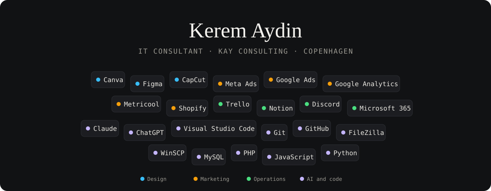

# Kerem Aydin

**IT consultant and business owner – KAY Consulting, Copenhagen**

I help owner-led companies grow through sales, business development and digital platforms – and I build the software myself. My focus is transport and logistics in the Nordics: freight exchanges, dispatch systems, carrier and customer portals and driver apps, as well as webshops and websites for small and medium-sized businesses.

My approach is practical: simple screens for busy people, fast pages, solid security and data stored in the EU. I work AI-first – I design the product, direct AI development agents, review and test the result, and put it into production.

## Selected projects

- **Fragtcentralen** – Nordic freight exchange for hauliers, forwarders and warehouses covering road, sea, air, rail and courier, with an integrated dispatch system: tour planning, fleet and trailer schedules, invoicing, settlement and a market overview based on open data from Statistics Denmark.
- **LVT Transport** – digital platform for an international transport company: customer portal, trucking portal, driver app, GPS tracking and 3D load planning.
- **BestMotors.dk** – webshop for ATVs, crossbikes, e-scooters and spare parts with parts lookup by vehicle model.
- **keremaydin.dk** – consulting website in Danish and English with price calculator and online booking.

Cases and services: [keremaydin.dk](https://keremaydin.dk)

## Tools I use

- **Design and content:** Canva, Figma, CapCut
- **Marketing and sales:** Meta Ads, Google Ads, Google Analytics, Metricool, Shopify
- **Operations and teamwork:** Trello, Notion, Discord, Microsoft 365
- **AI and development:** Claude, ChatGPT, Visual Studio Code, Git, GitHub, FileZilla, WinSCP, MySQL, PHP, JavaScript and Python – hosted in the EU

## Background

Trained freight forwarder with experience in sales, marketing and business development across transport and logistics, e-commerce, automotive, B2B safety equipment and events.

## Contact

[keremaydin.dk](https://keremaydin.dk) – Copenhagen, Denmark

Source code for client and company projects is private.
